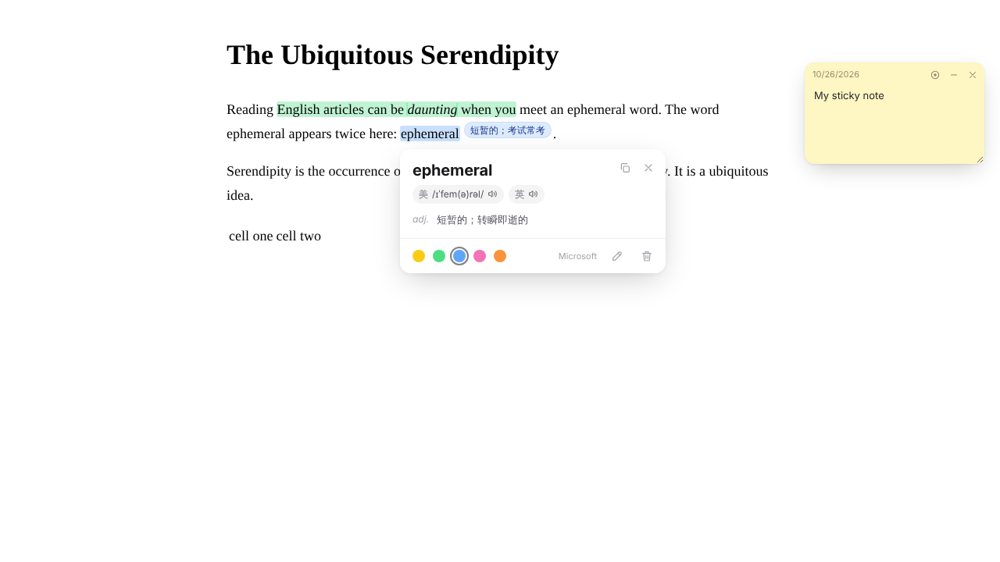
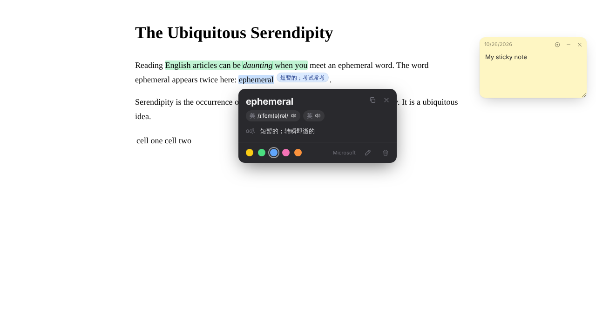

# ReadMark · 划词翻译与网页笔记

一个轻量的浏览器插件（Manifest V3）：在网页上**选词即译**、**双击记生词**，还能给网页加上**彩色高亮、旁注和便签**。所有笔记按网址自动保存在本地，下次打开同一网页自动恢复。

支持 **Microsoft Edge**、**Google Chrome**，也可以一键转换成 **Safari** 插件（macOS）。

无需注册、无需 API Key，开箱即用。

<table align="center">
  <tr>
    <th align="center">白天</th>
    <th align="center">夜间</th>
  </tr>
  <tr>
    <td></td>
    <td></td>
  </tr>
</table>

---

## 目录

- [为什么做这个插件](#为什么做这个插件)
- [功能](#功能)
- [下载](#下载)
- [安装到 Edge / Chrome](#安装到-edge--chrome)
- [安装到 Safari（macOS）](#安装到-safarimacos)
- [使用教程](#使用教程)
- [翻译源](#翻译源)
- [常见问题](#常见问题)
- [隐私说明](#隐私说明)
- [项目结构](#项目结构)
- [许可证](#许可证)

## 为什么做这个插件

我一直想通过浏览英文网页来提高英语水平，但现有的网页翻译工具大多是整页翻译或整段翻译：一键下去，满屏都是中文，英文原文反而被跳过了，读完也记不住几个词。

ReadMark 换了一种思路：**页面保持英文原样，只在遇到不认识的单词或短语时，由自己动手选中翻译**，并且可以随手高亮、写下自己的笔记。下次再读到这个网页，生词和笔记都还在原处。

查一次、记一笔、再见一面，陌生单词的印象就这样一点点加深。希望它能让你在日常浏览中不知不觉地学英语。

## 功能

| 功能 | 说明 |
| --- | --- |
| 🔤 **划词翻译** | 选中单词或句子，旁边自动弹出译文；单个英文单词显示音标和多个词性释义 |
| ⚡ **秒出词义** | 选中单词时同时查有道词典和翻译源，谁先返回先显示，音标稍后自动补上 |
| 🔊 **发音** | 点「美」「英」听美式 / 英式发音；取不到时自动改用系统英文语音 |
| ✍️ **双击记词义** | 双击英文单词，自动高亮并把词义写成旁注，背单词不用自己敲 |
| 🖍️ **彩色高亮** | 黄 / 绿 / 蓝 / 粉 / 橙五种颜色，点已高亮的文字可换色、写笔记或删除 |
| 📝 **旁注笔记** | 笔记以小标签显示在高亮文字旁边，鼠标悬停看全文 |
| 📌 **便签** | 在页面任意位置贴一张可拖动的便签 |
| 👁️ **笔记层开关** | 所有高亮、旁注、便签可一键显示 / 隐藏，还原干净的网页 |
| 💾 **自动保存** | 按网址保存在浏览器本地，重新打开网页自动恢复 |
| 📚 **管理页** | 搜索所有网页的笔记，导出 / 导入 JSON 备份，导出生词本 CSV（Excel 可直接打开） |
| 🌙 **深色模式** | 跟随系统自动切换 |

## 下载

任选一种：

- **直接下载**：点本页右上方绿色的 **Code** 按钮 → **Download ZIP**，解压后得到一个文件夹（里面有 `manifest.json`）。
- **用 git 克隆**（方便以后更新）：

  ```bash
  git clone https://github.com/Chen-Haonan567/readmark.git
  ```

> 下文把这个文件夹统称为 `readmark` 文件夹。用 Download ZIP 下载时文件夹名可能是 `readmark-main`，用法完全一样。
> 请把文件夹放在一个固定位置（比如「文档」里），**安装后不要删除或移动它**，否则插件会失效。

## 安装到 Edge / Chrome

1. 打开扩展管理页：
   - Edge：在地址栏输入 `edge://extensions/`
   - Chrome：在地址栏输入 `chrome://extensions/`
2. 打开 **开发人员模式**（Edge 在左侧栏底部，Chrome 在右上角）。
3. 点击 **加载解压缩的扩展**（Chrome 叫「加载已解压的扩展程序」），选择 `readmark` 文件夹。
4. 点击工具栏的拼图图标 🧩，把 **ReadMark** 固定到工具栏。
5. **已经打开的网页需要刷新一次**才能使用。

小提示：

- 快捷键可在 `edge://extensions/shortcuts` 或 `chrome://extensions/shortcuts` 修改。
- 更新插件：用新代码覆盖 `readmark` 文件夹（或 `git pull`），然后在扩展页面点 ReadMark 的「重新加载」🔄。笔记不会丢。
- Chrome 启动时可能提示「停用开发者模式扩展」，点右上角关掉提示即可，不影响使用。

## 安装到 Safari（macOS）

Safari 插件必须包在一个 Mac App 里，需要：

- macOS 13 / Safari 16.4 或更新版本
- 已安装 **Xcode**（在 Mac App Store 免费下载）

### 方法一：一键脚本（推荐）

1. 下载并解压本项目（比如放在「下载」文件夹，得到 `~/Downloads/readmark`）。
2. 打开「终端」，执行：

   ```bash
   bash ~/Downloads/readmark/safari/build-safari.sh
   ```

   脚本会在 `~/ReadMark-Safari` 生成 Xcode 工程并编译，把 `ReadMark.app` 装到 `~/Applications` 里并打开一次。
3. 打开 Safari 设置：
   - **高级**：勾选「显示网页开发者功能」；
   - **开发者**：勾选「允许未签名的扩展」；
   - **扩展**：勾选 ReadMark，点「编辑网站…」，把「其他网站」设为「允许」。
4. 刷新网页，选中文字试试。

**免去每次重启都要「允许未签名的扩展」**：用你的 Apple ID 签名即可（免费账号就行）。

1. 在 Xcode → 设置 → Accounts 里登录 Apple ID，记下 Team ID（10 位字母数字，在账号详情里能看到）。
2. 运行：

   ```bash
   TEAM_ID=你的TeamID bash ~/Downloads/readmark/safari/build-safari.sh
   ```

以后插件代码有更新，重新运行脚本即可，已有笔记会保留。

### 方法二：手动在 Xcode 里操作

1. 终端执行：

   ```bash
   xcrun safari-web-extension-converter ~/Downloads/readmark --app-name ReadMark --macos-only
   ```

   会自动打开 Xcode。
2. 在每个 Target 的 **Signing & Capabilities** 里，Team 选择你的 Apple ID。
3. 顶部选择 **My Mac**，点 ▶︎ 运行。
4. 按方法一第 3 步在 Safari 中启用。

### Safari 常见报错

- **提示找不到 `safari-web-extension-converter`**：先执行
  `sudo xcode-select -s /Applications/Xcode.app/Contents/Developer`
- **终端刷出一大段 `DVTCoreDeviceCore`、`CoreSimulator is out of date`**：这是 Xcode 与 macOS 版本不完全匹配的警告，不影响编译。想消掉可执行一次 `sudo xcodebuild -runFirstLaunch`。
- **快捷键不生效**：Safari 里快捷键是 ⌥⇧H / ⌥⇧N，偶尔会被占用，直接用工具栏弹窗里的开关即可。

## 使用教程

### 1. 划词翻译

在网页上**拖动选中**一个单词或一段文字，旁边会弹出翻译框：

- 单个英文单词：显示音标、各词性释义，点「美」「英」听发音；
- 句子 / 段落：显示整段译文；
- 点右上角 📋 复制译文，点 ✕ 关闭。

超过 1000 字的长段落不会自动翻译，点弹框里的「翻译」按钮即可。不想每次选中都弹框，可以在设置里关掉「选中文字后自动翻译」。

### 2. 双击记生词

**双击**一个英文单词，它会自动用默认颜色高亮，并把词义写成旁注贴在单词旁边。读完一篇文章，生词和释义都留在原文里了。

不需要这个功能时，在设置里关掉「双击单词时自动高亮，并把词义写成笔记」。拖动选择仍然只翻译、不记笔记。

### 3. 高亮与旁注

- 在翻译弹框底部点颜色圆点，即可高亮选中的文字；
- 点 ✏️（📝 笔记）写下想法，笔记会以小标签显示在高亮旁边，鼠标悬停看全文；
- 点击已经高亮的文字，可以**换颜色、改笔记或删除** 🗑️。

### 4. 便签

三种方式添加一张可拖动的便签：

- 点工具栏 ReadMark 图标 → 「添加便签」
- 在网页上点右键 → 「在这里添加便签」
- 快捷键 `Alt+Shift+N`（Mac 为 `⌥⇧N`）

便签可以拖动、折叠、关闭，内容自动保存。

### 5. 显示 / 隐藏笔记层

所有高亮、旁注、便签就像网页上多了一层透明纸。想看干净的原网页时：

- 点工具栏 ReadMark 图标里的开关，或
- 按 `Alt+Shift+H`（Mac 为 `⌥⇧H`）

### 6. 管理页（全部笔记、备份、生词本）

点工具栏 ReadMark 图标 → 「设置」打开管理页，可以：

- 切换翻译源、开关自动翻译和双击记词义；
- 查看、搜索所有网页的笔记，点击跳回原网页；
- **导出备份 / 导入备份**（JSON），用于换电脑或在 Edge、Chrome、Safari 之间迁移笔记；
- **导出生词本 CSV**，可直接用 Excel 打开复习。

## 翻译源

无需注册、无需 API Key，在设置里切换：

| 翻译源 | 说明 |
| --- | --- |
| Microsoft（默认） | Edge 自带翻译使用的免费接口，国内可直连 |
| Google 翻译 | 国内一般需要代理 |
| MyMemory | 免费，每天有额度限制 |

单词释义和发音来自有道词典。选定的翻译源失败时会自动换下一个。

> ⚠️ 这些都是免费的公开接口，并非官方承诺长期可用的服务。如果某个源失效，在设置里换一个即可。

## 常见问题

**选中文字没有弹框？**
插件安装或更新后，已打开的网页需要刷新一次。另外浏览器自带页面（如 `edge://`、`chrome://`、扩展商店）不允许插件运行。

**翻译失败？**
在设置里换一个翻译源试试；Google 翻译在国内一般需要代理。

**网页改版后高亮不见了？**
网页内容变化后，个别高亮可能找不到原文，它们仍然保存在管理页里。

**笔记会同步到其他电脑吗？**
不会。笔记只保存在本机浏览器中，请定期在管理页「导出备份」。

## 隐私说明

- 所有高亮、笔记、便签**只保存在你本机浏览器**（`chrome.storage.local`），不会上传到任何服务器。
- 只有你选中的文字会发送给所选的翻译源 / 有道词典，用于获取翻译和发音。
- 插件不收集任何个人信息，也没有统计代码。

## 项目结构

```
readmark/
├── manifest.json            插件配置
├── src/
│   ├── background.js        翻译请求、右键菜单、快捷键
│   ├── content.js           网页内：翻译弹框、高亮、旁注、便签、笔记层
│   └── content.css          高亮和旁注的样式
├── popup/                   工具栏弹窗（笔记层开关、添加便签）
├── options/                 管理页（设置、全部笔记、导入导出）
├── icons/                   图标
├── safari/build-safari.sh   Safari 一键构建脚本
└── docs/                    截图
```

## 参与贡献

欢迎提 [Issue](https://github.com/Chen-Haonan567/readmark/issues) 反馈问题或建议，也欢迎通过 Pull Request 直接给本仓库提交改进。

## 许可证

本项目采用 [CC BY-NC-ND 4.0](https://creativecommons.org/licenses/by-nc-nd/4.0/deed.zh-hans)（署名-非商业性使用-禁止演绎）许可，完整条款见 [LICENSE](LICENSE)。

- ✅ 可以免费下载、使用，也可以原样转发分享，但需注明作者并附上本仓库链接；
- ❌ 不可用于商业用途；
- ❌ 不可发布修改后的版本。
